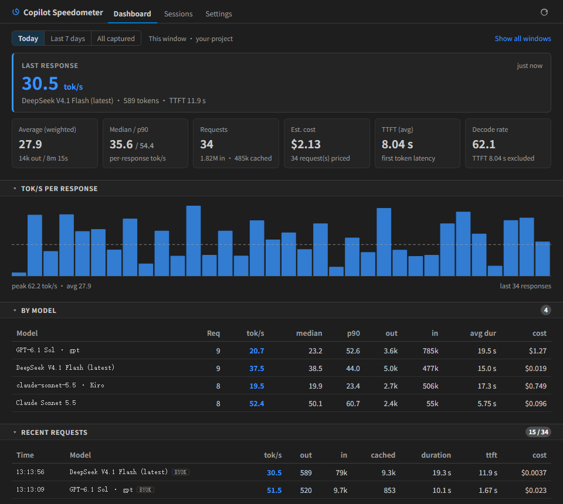
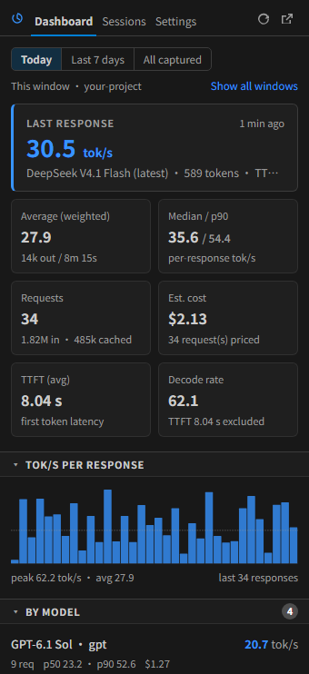
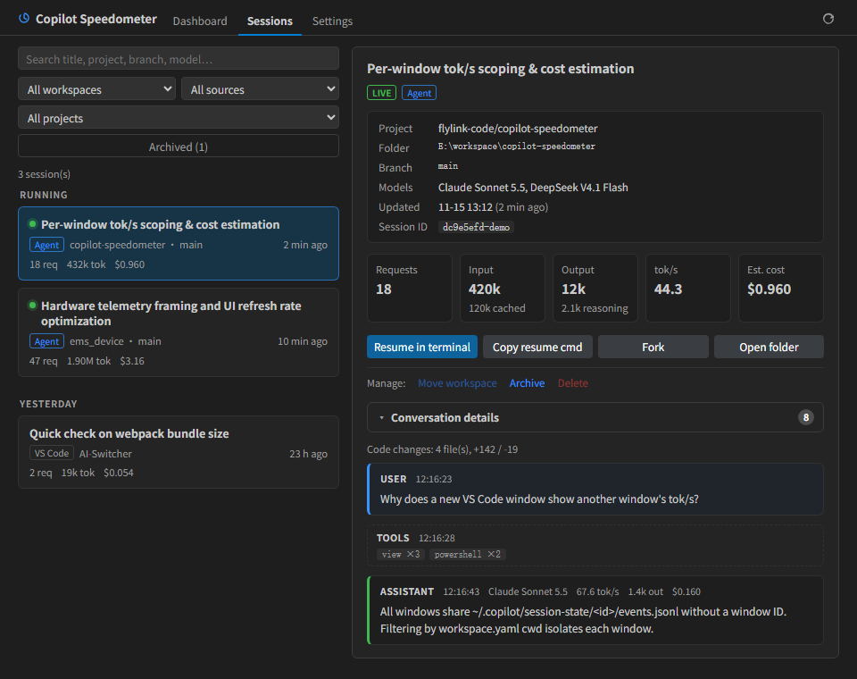
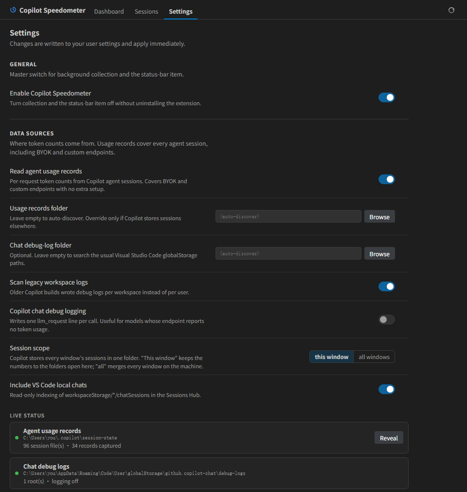

# Copilot Speedometer

**English** | [简体中文](README_zh.md)

See the **tokens/second**, TTFT, token usage, per-request duration, and estimated USD cost of GitHub Copilot Chat.

Works with **official models** and with **third-party / BYOK models** (Custom Endpoints, your own base URL — the `customendpoint/...` identifiers): if Copilot recorded the call, this extension can read it.

Everything comes from local files: no network calls, no upload, no private Copilot APIs.



## Why

The official Copilot UI shows token counts and credits but **never speed**. Two local files do carry the timing, and either one is enough to compute tok/s:

```
tok/s = outputTokens / (duration / 1000)
```

## Data sources (two, merged automatically)

| | A. Agent usage records | B. Chat debug logs |
|---|---|---|
| Path | `%USERPROFILE%\.copilot\session-state\<sessionId>\events.jsonl` | `%APPDATA%\Code\User\globalStorage\github.copilot-chat\debug-logs\<sid>\main.jsonl` |
| Needs a setting | ❌ no | ✅ `github.copilot.chat.agentDebugLog.fileLogging.enabled` |
| Covers BYOK / custom endpoints | ✅ yes (`isByok: true`) | only requests made inside Chat |
| TTFT | ✅ `timeToFirstTokenMs` | ❌ total duration only |
| Event | `session.usage_record` | `llm_request` |

A record from source A (one JSON object per line):

```json
{ "type": "session.usage_record",
  "timestamp": "2026-11-13T07:44:58.298Z",
  "data": { "usage": {
    "model": "magpie/gpt/gpt-6.1-sol", "modelDisplayName": "GPT-6.1 Sol · gpt",
    "inputTokens": 1203, "outputTokens": 402, "cacheReadTokens": 300,
    "duration": 4210, "timeToFirstTokenMs": 1100, "interTokenLatencyMs": 8,
    "isByok": true, "providerType": "openai", "apiCallId": "resp_byok_..." } } }
```

A record from source B:

```json
{ "type": "llm_request", "ts": 1763000000000, "dur": 4210,
  "attrs": { "model": "claude-sonnet-4.5", "inputTokens": 5230,
             "outputTokens": 412, "cachedTokens": 3000, "responseId": "..." } }
```

When both sources describe the same call, the A record wins because it carries TTFT. With neither source present the status bar shows `Copilot t/s`.

## Install

**Option A: Marketplace (recommended)**

Search for **Copilot Speedometer** in the Extensions view, or:

```bash
code --install-extension copilot-speedometer.copilot-speedometer
```

**Option B: local VSIX** (offline): `dist/copilot-speedometer-0.2.2.vsix`.

**Option C: from source**: open this folder in VS Code and press <kbd>F5</kbd> (Run Extension).

After installing, the status bar shows `⚡ 42.3 tok/s`; click it to open the panel.

## First run

- **BYOK / custom-endpoint users**: source A is already being written, so there is nothing to set up — the panel works immediately.
- **Official models only, and no data yet**: Copilot has to write debug logs. Click **Enable Copilot debug logging** in the panel, run `Copilot Speedometer: Enable Copilot Debug Logging` from the command palette, or add:

```json
"github.copilot.chat.agentDebugLog.fileLogging.enabled": true
```

Then **send a Copilot Chat message**; the status bar updates within two seconds.

> ⚠️ The debug-log switch writes the **full prompt and code context** to local disk. The extension only parses token and timing fields and never reads `user_message`.

On Insiders, `Code` becomes `Code - Insiders`. The legacy workspace layout `%APPDATA%\Code\User\workspaceStorage\<hash>\GitHub.copilot-chat\debug-logs\` is scanned too.

## Precision: three numbers, do not mix them

| Metric | Formula | Meaning |
|---|---|---|
| **Average throughput** (status-bar default) | `outputTokens / total duration` | end to end, including queueing, prefill and the first token |
| **TTFT** | `timeToFirstTokenMs` | time to first token (only source A) |
| **Decode rate** | `(outputTokens − 1) / (total − TTFT)` | pure generation speed (only source A, only meaningful when streaming) |

Two traps, both measured on real traffic:

1. **With a large context, "average throughput" is really prefill speed.** A request with a 100k-token context, 40 s TTFT and 41 s total yields 4 tok/s — that number measures how long the first token took, not how fast the model types. `Decode rate` is the number to look at.
2. **Non-streaming endpoints (many Custom Endpoints) have TTFT ≈ total duration.** For those, `duration − TTFT` is close to zero, so decode rate is withheld (shown as `—`) and only end-to-end throughput remains. On this machine only 24 of 569 BYOK records produced a decode rate.

Also: reasoning tokens count as output, tokenizers differ per vendor, and **tok/s is not strictly comparable across vendors**.

## Features

- **Persistent left sidebar**: clicking the Activity Bar icon or the status bar focuses the persistent left sidebar (Dashboard / Sessions Hub / Settings) without opening a new editor tab; an optional `↗` button in the header opens a wide editor tab if needed.



- **Instant historical conversation pickup**: focusing a window or resuming a historical Copilot conversation backfills that window's latest session even past `backfillDays` and wakes the status bar immediately; `autoHideMinutes` (default `5`) hides only the bottom-right status-bar item while the left sidebar remains visible.
- **Status bar & hover card**: shows the tok/s of the **last response in this window** (auto-hiding after five minutes of silence); hover for a 4-section summary card showing window scope, relative freshness, streaming **decode rate** (or `TTFT wait %` when prefill dominates), Duration / TTFT, Input / cache hit rate, Output tokens, today's totals + cumulative est. cost, and clickable **Sidebar / Editor tab / Refresh** command links.
- **Panel**: single-row icon header, a **Last response** hero card paired with an even KPI grid (weighted average / median / p90 / requests / est. cost / TTFT / decode rate), a per-response tok/s bar chart with dashed weighted-average line, a per-model summary with output-share bars, and the last 200 requests.
- **Sessions Hub**: a dedicated tab inside the panel to browse by time bucket (*Running / Today / Yesterday / Previous 7 days / Older*), search, filter by workspace/source/project/archived, and read full Copilot conversations (both Agent/CLI and local VS Code Chat) without opening a new window — using single-scroll drill-in on narrow sidebars and side-by-side split in wide tabs, with one-click terminal resume (`copilot --resume`), **Fork**, **Move workspace**, **Archive**, and **Delete** (protected by live-PID lock checks).


- **Per-window isolation**: Copilot writes every VS Code window's sessions into one `~/.copilot/session-state` folder and a usage record carries no window id. This extension compares the session's `cwd` (from `workspace.yaml`, or the `session.start` event in older sessions) with the folders open in this window — and, for a multi-root `.code-workspace` window, the workspace file — so a fresh window no longer shows another window's tok/s. A strip at the top of the panel states the current scope (N requests here · M hidden) and switches to "all windows" in one click. Adding or removing a folder rescopes immediately.
- **Settings tab inside the panel**: no need to hunt through VS Code settings for JSON — switches, numbers, paths (with Browse) and the status-bar mode live in the panel, apply immediately, and any overridden row offers ↻ to restore its default.
- Time windows: today / last 7 days / all. Switching to a longer window triggers a deeper backfill (each file is read from its tail, byte-budgeted, roughly one second the first time), so historical sessions show up as well.
- Commands: `Show Sidebar`, `Open in Editor Tab`, `Refresh`, `Enable Copilot Debug Logging`, `Export Captured Requests as JSON`, `Clear Captured History`, `Preview With Demo Data`, `Show Diagnostics`.
- History lives in memory (3000 records by default) and is backfilled for the last two days on startup.

## Settings



The **Settings** tab edits these values directly; `settings.json` still works:

| Setting | Default | Description |
|---|---|---|
| `copilotSpeedometer.enabled` | `true` | master switch |
| `copilotSpeedometer.statusBar` | `true` | show the status-bar item |
| `copilotSpeedometer.autoHideMinutes` | `5` | hide only the bottom-right status-bar item after this many minutes of silence (the left sidebar stays visible; 0 = never) |
| `copilotSpeedometer.statusBarFormat` | `"rate"` | status-bar content: `rate` number only / `rate-model` adds the model / `rate-ttft` adds TTFT |
| `copilotSpeedometer.sessionScope` | `"window"` | which sessions are counted: `window` only this window's folders / `all` every window on the machine |
| `copilotSpeedometer.usageEvents` | `true` | read agent usage records (the BYOK + TTFT source) |
| `copilotSpeedometer.usageEventsRoot` | `""` | override `~/.copilot/session-state` |
| `copilotSpeedometer.logPath` | `""` | point at a specific debug-logs root |
| `copilotSpeedometer.pollIntervalMs` | `2000` | polling interval (500–60000 ms) |
| `copilotSpeedometer.historySize` | `3000` | how many requests stay in memory (100–50000) |
| `copilotSpeedometer.backfillDays` | `2` | days to backfill on startup (0–365) |
| `copilotSpeedometer.includeLegacyWorkspaceLogs` | `true` | also scan the legacy workspaceStorage layout |
| `copilotSpeedometer.includeVscodeChats` | `true` | list local VS Code Chat sessions in the Sessions Hub |
| `copilotSpeedometer.pricingMultiplier` | `1` | multiplier applied to catalog USD prices (1 = standard list price) |
| `copilotSpeedometer.customPricing` | `{}` | custom per-model USD pricing per 1M tokens |

`github.copilot.chat.agentDebugLog.fileLogging.enabled` also lives in the Settings tab under Data sources; the Live status block below the fields shows whether it is currently on.

Every string in the panel and in the status bar follows the VS Code display language (English / 简体中文).

## FAQ

**The status bar keeps showing `Copilot t/s` with no number**: run `Copilot Speedometer: Show Diagnostics` first — it prints which roots were scanned, how many files were found and how many records were captured.
1. Does "Reading" in the panel list directories that actually exist?
2. Is `~\.copilot\session-state` present? If it is, there should be data.
3. After using Copilot, wait two seconds or press Refresh.
4. On remote / containers / WSL the data lives on the **remote** side, so the extension has to be installed there too.

**The numbers look too low**: check TTFT first. If TTFT is close to the total duration you hit trap 1 above — look at decode rate or shrink the context.

**A new window shows another window's tok/s**: fixed in 0.1.1. Copilot writes every window's sessions into `~/.copilot/session-state` and the records carry no window id, so the session's `cwd` is the only discriminator. The extension reads it from `workspace.yaml` (or the `session.start` event for older sessions) and drops anything that does not match this window's folders. Set `copilotSpeedometer.sessionScope` to `all` — or click "Show all windows" in the panel's scope strip — to count every session. A window with no folder open cannot be scoped, so it shows everything.

**The panel is empty**: run `Preview With Demo Data` to see the UI with synthetic data (not real traffic).

## How it compares

| Extension | tok/s | TTFT | BYOK | Notes |
|---|---|---|---|---|
| **this one** | ✅ | ✅ | ✅ | the only one that treats tok/s as the primary metric and reads both usage records and debug logs |
| [Copilot Tokens](https://marketplace.visualstudio.com/items?itemName=yuyuanjingxuan.copilot-tokens) | ❌ | ❌ | partial | has Duration + Output per request; dividing them yourself gives tok/s |
| [Copilot Token Meter](https://marketplace.visualstudio.com/items?itemName=YoussefSaleh.copilot-token-meter) | ❌ | ❌ | ❌ | tokens + credits, reads `~/.copilot/session-store.db` |
| [AI Engineering Fluency](https://marketplace.visualstudio.com/items?itemName=RobBos.ai-engineering-fluency) | ❌ | ❌ | ❌ | token usage / cost / fluency dashboard |

## Development

```bash
npm test                       # parser / stats / scope / pricing / sessions / settings / i18n unit tests (71)
node tools/smoke-activate.js    # runs activate / tick / panel payloads against a stubbed vscode API
node tools/preview.js          # renders docs/preview*.html and screenshots in both languages
npm run package                # builds the .vsix into dist/ (vsce flags included)
```

Layout:

```
src/usage-events.js  source A: session-state scanning, incremental tailing, record mapping
src/parser.js        source B: debug-logs scanning, incremental tailing, record mapping
src/scope.js         per-window attribution: cwd from workspace.yaml / workspace.json
src/pricing.js       offline model pricing catalog, prefix normalization, cost estimation
src/sessions.js      read-only Sessions Hub index and conversation reader (Agent + VS Code Chat)
src/stats.js         aggregation and formatting (pure functions, unit-tested)
src/settings.js      panel settings model: field table, validation, write / reset (host side, no vscode import)
src/i18n.js          English + Chinese dictionaries and the translator
src/webview.js       panel HTML (Dashboard + Sessions Hub + Settings views, CSP nonce, follows the VS Code theme)
src/extension.js     status bar, polling, two-source merge and dedupe, commands, panel messages
```

## License

MIT
