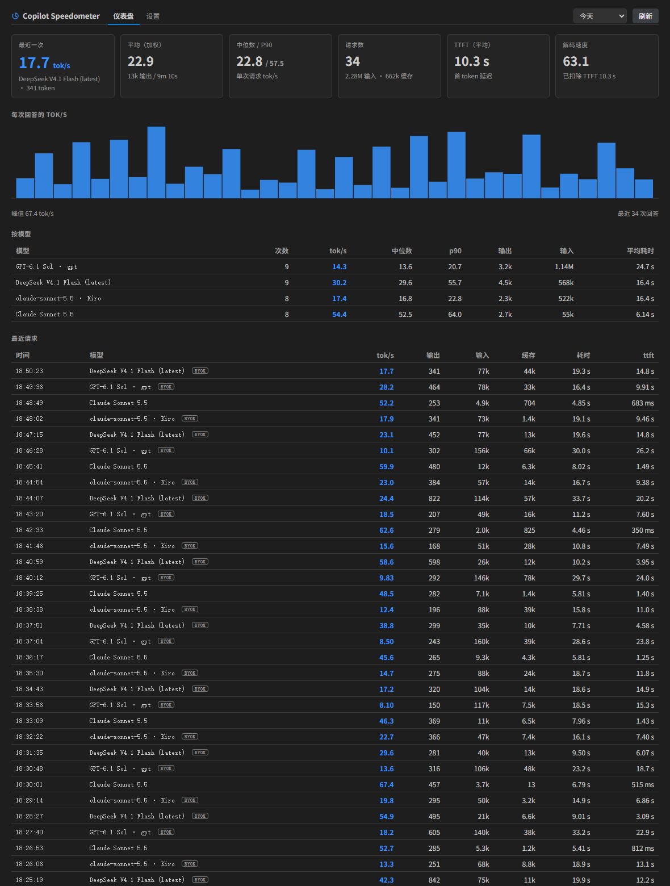
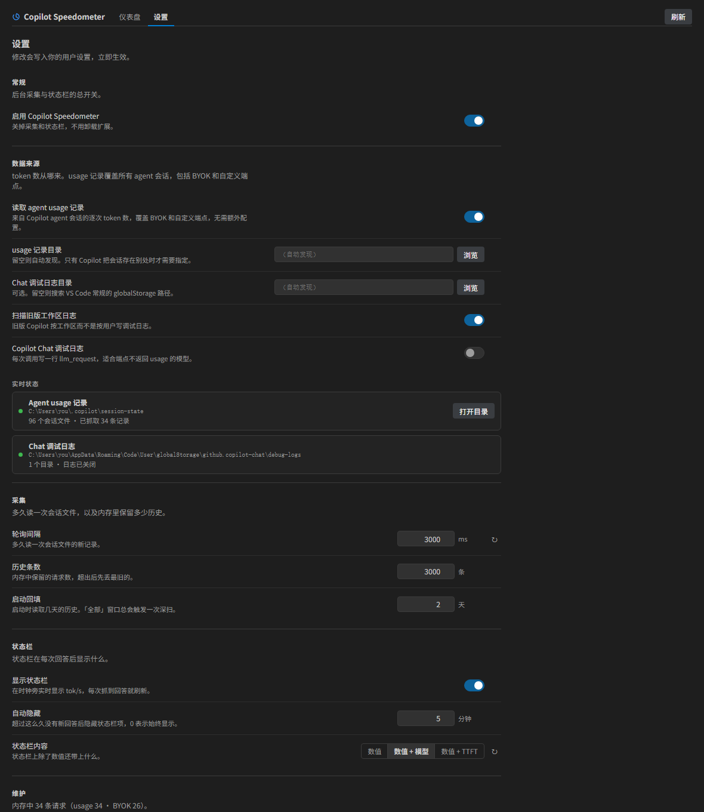

# Copilot Speedometer

**中文** | [English](README_en.md)

看 GitHub Copilot Chat 的 **tokens/second**、TTFT、token 用量和每次请求的耗时。

支持**官方模型**和**第三方 / BYOK 模型**（Custom Endpoint、自定义 base URL 那些 `customendpoint/...` 模型）——只要 Copilot 自己记录了这次调用，本扩展就能读到。

数据全部来自本地文件：不联网、不上传、不调用任何 Copilot 内部 API。



## 为什么需要它

Copilot 官方 UI 只显示 token 数和 credits，**没有速度**。而本地有两份带耗时的记录，任意一份都可以算出 tok/s：

```
tok/s = outputTokens / (duration / 1000)
```

## 数据来源（两个，自动合并）

| | A. Agent usage records | B. Chat debug logs |
|---|---|---|
| 路径 | `%USERPROFILE%\.copilot\session-state\<sessionId>\events.jsonl` | `%APPDATA%\Code\User\globalStorage\github.copilot-chat\debug-logs\<sid>\main.jsonl` |
| 需要开开关 | ❌ 不需要 | ✅ `github.copilot.chat.agentDebugLog.fileLogging.enabled` |
| 覆盖 BYOK / 自定义端点 | ✅ 是（`isByok: true`） | 只覆盖 Chat 内的请求 |
| TTFT | ✅ 有 `timeToFirstTokenMs` | ❌ 只有总时长 |
| 事件 | `session.usage_record` | `llm_request` |

A 的字段长这样（每行一个 JSON）：

```json
{ "type": "session.usage_record",
  "timestamp": "2026-11-13T07:44:58.298Z",
  "data": { "usage": {
    "model": "magpie/gpt/gpt-6.1-sol", "modelDisplayName": "GPT-6.1 Sol · gpt",
    "inputTokens": 1203, "outputTokens": 402, "cacheReadTokens": 300,
    "duration": 4210, "timeToFirstTokenMs": 1100, "interTokenLatencyMs": 8,
    "isByok": true, "providerType": "openai", "apiCallId": "resp_byok_..." } } }
```

B 的字段：

```json
{ "type": "llm_request", "ts": 1763000000000, "dur": 4210,
  "attrs": { "model": "claude-sonnet-4.5", "inputTokens": 5230,
             "outputTokens": 412, "cachedTokens": 3000, "responseId": "..." } }
```

同一次调用若两边都有，只保留带 TTFT 的 A 记录。两份都没有时状态栏显示 `Copilot t/s`。

## 安装

**方式 A：VSIX（推荐）**

```bash
code --install-extension dist/copilot-speedometer-0.4.0.vsix
```

**方式 B：源码调试**：用 VS Code 打开本目录，按 <kbd>F5</kbd>（Run Extension）。

安装后右下角状态栏出现 `⚡ 42.3 tok/s`，点击打开面板。

## 首次使用

- **BYOK / 自定义端点用户**：你已经在写 A 了，装完不用做任何事，直接看面板。
- **只有官方模型、且没有任何数据**：需要让 Copilot 写调试日志 —— 点面板里的 **Enable Copilot debug logging**，或命令面板运行 `Copilot Speedometer: Enable Copilot Debug Logging`，或手动加：

```json
"github.copilot.chat.agentDebugLog.fileLogging.enabled": true
```

然后**发一条 Copilot Chat 消息**，状态栏最长 2 秒内更新。

> ⚠️ 调试日志开关会把**完整 prompt 和代码上下文**写入本地磁盘。扩展本身只解析 token 与耗时字段，不读 `user_message`。

Insiders 把 `Code` 换成 `Code - Insiders`；旧版 workspace 布局 `%APPDATA%\Code\User\workspaceStorage\<hash>\GitHub.copilot-chat\debug-logs\` 也会自动扫。

## 精度：三个数，别混用

| 指标 | 公式 | 含义 |
|---|---|---|
| **平均吞吐**（状态栏默认） | `outputTokens / 总耗时` | 端到端，含排队 + prefill + 首 token |
| **TTFT** | `timeToFirstTokenMs` | 首 token 延迟（仅 A 有） |
| **Decode rate** | `(outputTokens − 1) / (总耗时 − TTFT)` | 纯生成速度（仅 A 且流式时有意义） |

两个坑，都实测过：

1. **大上下文时「平均吞吐」≈ prefill 速度，不是生成速度。** 上下文 10 万 token、TTFT 40 s、总耗时 41 s 的请求，算出来 4 tok/s —— 那个数字衡量的是首 token 多久到，不是模型吐字多快。看 `Decode rate` 才有意义。
2. **非流式端点（含很多 Custom Endpoint）TTFT ≈ 总耗时。** 这类请求 `duration − TTFT` 接近 0，decode rate 会被判为不可用（显示 `—`），只留端到端吞吐。实测 569 条 BYOK 记录里只有 24 条能算出 decode rate。

另外：reasoning token 计入 output，各厂商 tokenizer 不同，**tok/s 跨厂商不完全可比**。

## 功能

- 状态栏实时显示**上一次回答**的 tok/s（默认 5 分钟没新回答就自动隐藏，不占用不聊天的窗口），悬停看模型、BYOK 标记、输出 token、耗时、TTFT、最近 20 次加权平均与中位数。
- 面板：卡片（最近一次 / 加权平均 / 中位数 / p90 / 请求数 / TTFT / decode rate）、每次回答的 tok/s 柱状图、按模型汇总、最近 200 条请求明细。
- **面板内的 Settings 页**：不用去 VS Code 设置里翻 JSON —— 开关、数字、路径（带 Browse）和状态下拉都在面板里，改完立即生效，被改过的项旁边有 ↻ 可一键恢复默认。
- 时间窗口：今天 / 近 7 天 / 全部。切到「近 7 天」或「全部」时会做一次更深的回填（每个文件读尾部、总量有上限，首次约 1 秒），所以历史会话也能看到。
- 命令：`Show Dashboard`、`Refresh`、`Enable Copilot Debug Logging`、`Export Captured Requests as JSON`、`Clear Captured History`、`Preview With Demo Data`、`Show Diagnostics`。
- 历史在内存里（默认 3000 条），启动时回填最近 2 天。

## 设置



面板里的 **Settings** 标签页直接改这些值，也可以照旧在 `settings.json` 里写：

| 设置 | 默认 | 说明 |
|---|---|---|
| `copilotSpeedometer.enabled` | `true` | 总开关 |
| `copilotSpeedometer.statusBar` | `true` | 是否显示状态栏 |
| `copilotSpeedometer.autoHideMinutes` | `5` | 多久没有新回答就自动隐藏状态栏项（0 = 不隐藏） |
| `copilotSpeedometer.statusBarFormat` | `"rate"` | 状态栏内容：`rate` 只有数字 / `rate-model` 加模型名 / `rate-ttft` 加 TTFT |
| `copilotSpeedometer.usageEvents` | `true` | 读 agent usage records（BYOK + TTFT 来源） |
| `copilotSpeedometer.usageEventsRoot` | `""` | 覆盖 `~/.copilot/session-state` |
| `copilotSpeedometer.logPath` | `""` | 手动指定 debug-logs 根目录 |
| `copilotSpeedometer.pollIntervalMs` | `2000` | 轮询间隔（500–60000 ms） |
| `copilotSpeedometer.historySize` | `3000` | 内存中保留的请求条数（100–50000） |
| `copilotSpeedometer.backfillDays` | `2` | 启动时回填几天（0–365） |
| `copilotSpeedometer.includeLegacyWorkspaceLogs` | `true` | 是否扫旧版 workspaceStorage 布局 |

`github.copilot.chat.agentDebugLog.fileLogging.enabled` 也在 Settings 页的 Data sources 里，切换后会在下面的 Live status 里显示当前是开还是关。

面板与状态栏的文案跟随 VS Code 界面语言（中文 / English），切换界面语言后重载窗口即可。

## 常见问题

**状态栏一直显示 `Copilot t/s`（无数字）**：先跑命令 `Copilot Speedometer: Show Diagnostics`，它会把扫了哪些根目录、找到几个文件、抓到多少条记录全打出来。
1. 面板里 "Reading" 是否列出了真实存在的目录；
2. `~\.copilot\session-state` 在不在（在就说明应该有数据）；
3. 用过 Copilot 之后等 2 秒或点 Refresh；
4. 如果你用的是 remote / 容器 / WSL，数据在**远端**，需要把扩展装到远端。

**数字明显偏低**：先看 TTFT —— 如果 TTFT 接近总耗时，说明你踩的是上面第 1 个坑，看 decode rate 或换小的上下文。

**面板空白**：命令 `Preview With Demo Data` 可以先看 UI（合成数据，不是真实流量）。

## 和现有插件的区别

| 插件 | tok/s | TTFT | BYOK | 说明 |
|---|---|---|---|---|
| **本扩展** | ✅ | ✅ | ✅ | 唯一把 tok/s 作为主指标，且同时读 usage records 和 debug logs |
| [Copilot Tokens](https://marketplace.visualstudio.com/items?itemName=yuyuanjingxuan.copilot-tokens) | ❌ | ❌ | 部分 | 有每次请求的 Duration + Output，自己除就是 tok/s |
| [Copilot Token Meter](https://marketplace.visualstudio.com/items?itemName=YoussefSaleh.copilot-token-meter) | ❌ | ❌ | ❌ | token + credits，读 `~/.copilot/session-store.db` |
| [AI Engineering Fluency](https://marketplace.visualstudio.com/items?itemName=RobBos.ai-engineering-fluency) | ❌ | ❌ | ❌ | token 用量/成本/fluency 面板 |

## 开发

```bash
npm test                       # 解析 / 统计 / 设置 / 本地化单测（44 项）
node tools/smoke-activate.js    # 用 stub 的 vscode API 真跑一遍 activate / tick / 面板 payload
node tools/preview.js          # 生成 docs/preview*.html 与中英两套截图，浏览器直接看 UI
npm run package                # 打包 .vsix（vsce 参数已内置）
```

结构：

```
src/usage-events.js  A 源：session-state 扫描 + 增量 tail + 记录映射
src/parser.js        B 源：debug-logs 扫描 + 增量 tail + 记录映射
src/stats.js         聚合与格式化（纯函数，可单测）
src/settings.js      面板设置模型：字段表、校验、写入/恢复默认（host 侧，无 vscode 依赖）
src/i18n.js          中英字典与翻译函数
src/webview.js       面板 HTML（Dashboard + Settings 两个视图，CSP nonce，主题跟随 VS Code）
src/extension.js     状态栏、轮询、双源合并去重、命令、面板消息
```

## License

MIT
